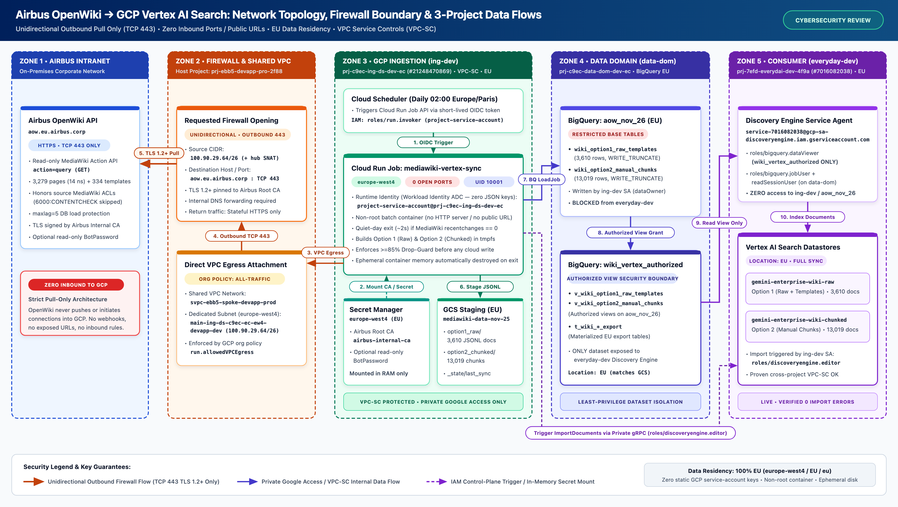
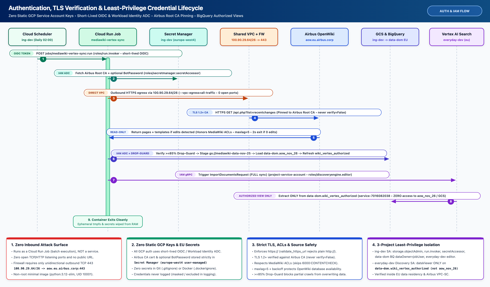

# Cybersecurity Review Package: Airbus OpenWiki → 3-Project GCP Pipeline

> **Executive Security Summary (3-Project Architecture — Verified Live)**
> - **Unidirectional Outbound Pull Only**: Requests a single outbound HTTPS (`TCP 443`) firewall rule from Shared VPC subnet `main-ing-ds-c9ec-ec-ew4-devapp-dev` (`100.90.29.64/26`, `europe-west4`) to `aow.eu.airbus.corp:443`. **Zero inbound ports or public URLs** exist on GCP.
> - **Zero Inbound Attack Surface**: Runs as a serverless **Cloud Run Job** (batch task, non-root `UID 10001`), **not** a web service—listens on zero TCP ports and has no public `.run.app` endpoint.
> - **Strict 3-Project Separation & Data Isolation**:
>   1. **`ing-dev` (`prj-c9ec-ing-ds-dev-ec`, `#21248470869`)**: Crawls OpenWiki, preprocesses in ephemeral tmpfs, stages JSONL in `gs://mediawiki-data-nov-25` (`EU`).
>   2. **`data-dom` (`prj-c9ec-data-dom-dev-ec`)**: Hosts restricted BigQuery base tables (`aow_nov_26`, `EU`) and **BigQuery Authorized Views** (`wiki_vertex_authorized`, `EU`).
>   3. **`everyday-dev` (`prj-7efd-everydai-dev-4f9a`, `#7016082038`)**: Hosts Vertex AI Search datastores (`eu`); reads strictly from `data-dom.wiki_vertex_authorized` with zero access to `aow_nov_26` or `ing-dev` GCS.
> - **End-to-End Encryption & EU Residency**: TLS 1.2+ pinned to Airbus internal Root CA (`MEDIAWIKI_CA_BUNDLE`); all GCP assets remain in **EU (`europe-west4` / `EU` / `eu`)** inside **VPC Service Controls (VPC-SC)**.

---

## 1. Network Topology, Firewall Boundary & 3-Project Data Flows

*(Vector source: [diagram_1_network_and_data_flows.svg](diagram_1_network_and_data_flows.svg))*

---

## 2. Authentication, TLS Verification & Least-Privilege Credential Lifecycle

*(Vector source: [diagram_2_auth_and_security_sequence.svg](diagram_2_auth_and_security_sequence.svg))*

---

## 3. Firewall & Network Flow Specification Table

| Field | Value |
| :--- | :--- |
| **Flow Direction** | **Unidirectional Outbound Pull** (`GCP Cloud Run` → `Airbus Corporate Intranet`). **No inbound rules** into GCP. |
| **GCP Service Project (`ing-dev`)** | `prj-c9ec-ing-ds-dev-ec` (`#21248470869`, VPC-SC Protected) |
| **GCP BigQuery Project (`data-dom`)** | `prj-c9ec-data-dom-dev-ec` (`aow_nov_26` & `wiki_vertex_authorized`, `EU`) |
| **GCP Consumer Project (`everyday-dev`)** | `prj-7efd-everydai-dev-4f9a` (`#7016082038`, Vertex AI Search `eu`) |
| **Shared VPC Host Project / Network** | `prj-ebb5-devapp-pro-2f88` / `svpc-ebb5-spoke-devapp-prod` |
| **Source Subnet & Region** | `main-ing-ds-c9ec-ec-ew4-devapp-dev` (`europe-west4`, `--vpc-egress=all-traffic`) |
| **Source IP / CIDR** | **`100.90.29.64/26`** *(plus corresponding Airbus hub SNAT IP if `100.90.x.x` spoke traffic is NAT'd toward on-prem)* |
| **Destination FQDN & Port** | `aow.eu.airbus.corp` — **TCP `443` (`HTTPS`)** |
| **Transport Security** | **TLS 1.2+** strictly verified against Airbus Root CA (`MEDIAWIKI_CA_BUNDLE`); `http://` rejected in code (`validate_https_url`). |
| **API Operations** | Read-only MediaWiki Action API (`action=query`, `maxlag=5` DB protection) + optional `action=login` (`Special:BotPasswords`). Zero write/edit calls. |
| **GCP Internal Flows** | All cross-project GCP traffic traverses Google's private backbone (Private Google Access) within **VPC-SC** (verified end-to-end). |

---

## 4. Identity & Least-Privilege IAM Summary

| Identity | Target Project / Resource | Role(s) | Auth Mechanism |
| :--- | :--- | :--- | :--- |
| `project-service-account@prj-c9ec-ing-ds-dev-ec.iam.gserviceaccount.com` | `prj-c9ec-ing-ds-dev-ec` (`ing-dev`) | `roles/storage.objectAdmin` (bucket), `roles/run.invoker`, `roles/secretmanager.secretAccessor` | Short-lived OIDC / Workload Identity ADC (0 static keys) |
| `project-service-account@prj-c9ec-ing-ds-dev-ec.iam.gserviceaccount.com` | `prj-c9ec-data-dom-dev-ec` (`data-dom`) | `roles/bigquery.dataOwner`, `roles/bigquery.jobUser` | Workload Identity ADC (Private Google Access) |
| `project-service-account@prj-c9ec-ing-ds-dev-ec.iam.gserviceaccount.com` | `prj-7efd-everydai-dev-4f9a` (`everyday-dev`) | `roles/discoveryengine.editor` *(pending admin grant)* | Workload Identity ADC (Private gRPC) |
| `service-7016082038@gcp-sa-discoveryengine.iam.gserviceaccount.com` | `prj-c9ec-data-dom-dev-ec` (`data-dom`) | `roles/bigquery.dataViewer` (**dataset `wiki_vertex_authorized` ONLY**), `roles/bigquery.jobUser`, `roles/bigquery.readSessionUser` | Google-managed Service Agent (zero access to `aow_nov_26` or `ing-dev`) |
| OpenWiki Read-Only `BotPassword` *(if anonymous read is disabled)* | `aow.eu.airbus.corp/api.php` | MediaWiki Read-Only (`Basic rights`) | Stored in EU Secret Manager (`europe-west4`), mounted in RAM only |

---

## 5. Defense-in-Depth Controls Summary

| Control Domain | Implementation in Code & Infrastructure |
| :--- | :--- |
| **No Exposed Listener** | Deployed as a **Cloud Run Job** (`Dockerfile`), not a web service—zero open TCP ports and no public URL. |
| **Container Hardening** | Minimal `python:3.12-slim` image running as non-root `appuser` (`UID 10001`, `/usr/sbin/nologin`); ephemeral tmpfs wiped on exit. |
| **Zero Static GCP Keys** | All GCP-to-GCP auth uses short-lived **Workload Identity / ADC** and OIDC tokens—zero JSON key files. |
| **Secret Management** | Airbus CA cert and optional MediaWiki `BotPassword` stored in **GCP Secret Manager** pinned to `europe-west4` (`user-managed` EU replication); excluded from Git/Docker via `.gitignore` and `.dockerignore`; never logged. |
| **3-Project Data Isolation** | `everyday-dev` (`service-7016082038@gcp-sa-discoveryengine.iam.gserviceaccount.com`) is granted `roles/bigquery.dataViewer` **solely** on `prj-c9ec-data-dom-dev-ec.wiki_vertex_authorized`—blocking direct access to `aow_nov_26` and `ing-dev` GCS. |
| **Source ACL Enforcement** | Crawler respects MediaWiki read ACLs (`readapidenied` namespaces like `6000:CONTENTCHECK` are skipped automatically). |
| **Injection & Integrity Guards** | Strict allow-list regex validation on GCP project/dataset/table identifiers (`5_vertex_import_jsonl.py`), path containment (`wiki_utils.py`), and an **85% drop-guard** (`run_pipeline.py`) aborting cloud writes on partial crawls. |
